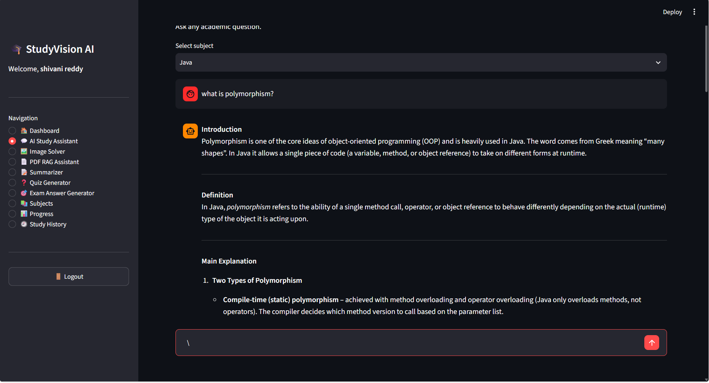

# 📚 StudyVision_AI

### 🤖 An AI-Powered Study Companion for Smarter Learning

<p align="center">
  
</p>

StudyVision_AI is a smart AI-based learning assistant designed to help students understand concepts, clear doubts, and study more effectively. It provides a simple, interactive, and personalized learning experience using Artificial Intelligence.

---

## ✨ Features

- 🤖 **AI Study Assistant** – Get instant help with academic questions.
- 💬 **Doubt Clearing** – Ask questions and get simple explanations.
- 📚 **Smart Learning** – Understand difficult topics easily.
- 📄 **PDF Support** – Learn from study materials and documents.
- 🧠 **AI-Powered Responses** – Get intelligent and context-based answers.
- 🔐 **User Authentication** – Secure user login and management.
- 💾 **Database Support** – Manage application and user data.
- 🎯 **Student-Friendly Interface** – Simple and easy-to-use design.

---

## 🛠️ Technologies Used

- 🐍 **Python**
- 🎨 **Streamlit**
- 🧠 **Google Gemini API**
- 🗄️ **SQLite**
- 📄 **PDF Processing**
- 🔎 **RAG (Retrieval-Augmented Generation)**
- 🤖 **Large Language Models (LLMs)**

---

## 📂 Project Structure

```text
StudyVision_AI/
│
├── assets/
│   └── logo.png
│
├── data/
│   └── studyvision.db
│
├── utils/
│   ├── __init__.py
│   ├── ai.py
│   ├── auth.py
│   ├── pdf_utils.py
│   ├── prompts.py
│   └── rag.py
│
├── app.py
├── database.py
├── requirements.txt
├── test_gemini.py
├── .gitignore
└── README.md